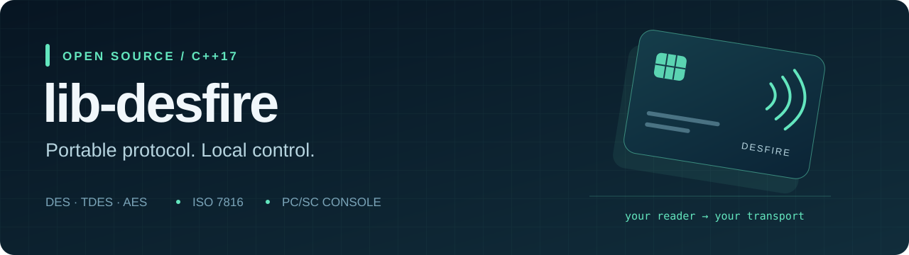
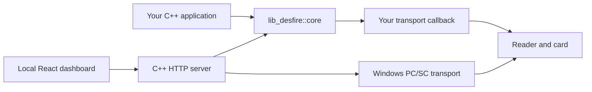

<div align="center">



# lib-desfire

**A portable C++17 DESFire library. A native Windows card console. Your reader, your transport.**

[](https://github.com/GtechGovind/lib-desfire/actions/workflows/ci.yml)
[](https://github.com/GtechGovind/lib-desfire/actions/workflows/codeql.yml)
[](https://github.com/GtechGovind/lib-desfire/actions/workflows/release.yml)
[](https://en.cppreference.com/w/cpp/17)
[](LICENSE)
[](https://github.com/sponsors/GtechGovind)

[Get started](#get-started) · [Documentation](https://gtechgovind.github.io/lib-desfire/) · [Discussions](https://github.com/GtechGovind/lib-desfire/discussions) · [Contribute](CONTRIBUTING.md) · [Sponsor](#support-the-project)

</div>

Build DESFire applications without tying the protocol to one reader SDK. The core
handles authentication, secure messaging and card commands behind a synchronous
transport callback. The optional dashboard connects those capabilities to a local
React interface through Windows PC/SC.

## What you can build

| Capability | Included |
| --- | --- |
| Authentication | DES, two-key/three-key TDES and AES key families; session management |
| Secure messaging | Plain, MACed and enciphered communication for implemented authentication families |
| Applications and keys | Select, create and delete applications; inspect and change key settings |
| Native files | Standard data, backup data, value, linear record and cyclic record files |
| Data operations | Read/write data and records, value operations, commit and abort transactions |
| ISO 7816 | Standard selection, binary and record commands, authentication and secure messaging |
| Transport | Application-supplied native and APDU callbacks with bounded operations and delivery outcomes |
| Windows console | PC/SC reader selection, typed commands, raw APDUs, activity history and in-memory credentials |

The implemented command set is described by the [public API](lib/include/desfire/card.hpp)
and [dashboard catalog](src/dashboard/commands.json). Card generation, configuration,
key family and reader support must be qualified on your hardware; this project does
not claim universal EV1/EV2/EV3 coverage or vendor certification.

## Two ways to use it



**Embed the core:** portable C++17, OpenSSL Crypto and threads. Reader drivers and
application dependencies stay outside the public interface.

**Run the console:** one native Windows process serves the built frontend on
`127.0.0.1:8765`. Node.js is a build dependency; the deployed console runs without it.

## Get started

### Build the core

You need **CMake 3.24+**, a **C++17 compiler**, **OpenSSL development files** and
thread support. See [building](docs/building.md) for toolchain and OpenSSL setup.

```sh
git clone https://github.com/GtechGovind/lib-desfire.git
cd lib-desfire
cmake -S . -B build/core -DCMAKE_BUILD_TYPE=Release
cmake --build build/core --config Release --parallel
cmake --install build/core --config Release --prefix install
```

Use `-Dlib_desfire_build_shared=ON` for a shared library. The dashboard is disabled
by default. On Debian/Ubuntu, install `build-essential cmake libssl-dev` first;
on macOS, install CMake and OpenSSL with your package manager.

### Link your application

```cmake
find_package(lib_desfire 0.2 CONFIG REQUIRED)
target_link_libraries(your_application PRIVATE lib_desfire::core)
```

Configure the consumer with `-DCMAKE_PREFIX_PATH=/absolute/path/to/install`.
For an embedded source checkout, use `add_subdirectory(path/to/lib-desfire)` and
link the same target.

```cpp
#include <desfire.hpp>

// Implement this adapter with your reader SDK. Return native replies as
// status-first bytes, honor the deadline, and send each frame exactly once.
desfire::result<desfire::bytes> exchange_native(
    const std::uint8_t* request, std::size_t size, desfire::deadline until);

void inspect_card() {
    desfire::card card{exchange_native};
    auto version = card.get_version();
    if (!version) {
        const auto& error = version.get_error();
        // Inspect error.code and error.outcome before deciding what happens next.
        // Unknown delivery requires reconnection and card-state inspection.
        (void)error;
        return;
    }
    // version.value() contains hardware/software and manufacturing fields.
}
```

The reader must activate the card before constructing its host session. Native
and standard APDU callbacks have different response layouts; see their
[transport contracts](lib/include/desfire/transport). A complete
[offline consumer example](examples/consumer) verifies package discovery and
failure handling without a reader.

### Build the Windows dashboard

Use a Windows developer terminal with a C++ compiler, CMake, OpenSSL and
**Node.js 22.12+** with npm:

```powershell
cmake -S . -B build/dashboard -Dlib_desfire_build_dashboard=ON -DCMAKE_BUILD_TYPE=Release
cmake --build build/dashboard --config Release --parallel
# Ninja / other single-configuration generators:
./build/dashboard/desfire_dashboard.exe
# Visual Studio / other multi-configuration generators:
./build/dashboard/Release/desfire_dashboard.exe
```

Open **http://127.0.0.1:8765**, select a reader and connect. Run the executable
with `--help` for port and asset-directory options. Keep `web` beside the binary;
see [distribution requirements](docs/building.md#distribution) for native runtimes
and OpenSSL provider modules.

## Explicit control over card operations

- Commands run only on request and are never retried automatically.
- Persistent mutations and raw sends in the dashboard require a target review.
- Unknown delivery requires explicit reconnection and card-state inspection.
- Raw traffic invalidates the typed session; reconnect before typed commands.
- Saved credentials exist only in process memory. Exports may contain card data.

Use authorized cards and readers. Keep the console on a trusted local workstation.
Read the [security model and reporting policy](SECURITY.md) before deployment.

## Documentation

| Guide | Start here for |
| --- | --- |
| [Building](docs/building.md) | Dependencies, compiler setup, installation and frontend development |
| [Architecture](docs/architecture.md) | Protocol boundaries, request flow and session ownership |
| [HTTP API](docs/http-api.md) | Routes, arguments, errors and concurrency |
| [Public headers](lib/include) | Bounds, ownership, state transitions and transport contracts |
| [Contributing](CONTRIBUTING.md) | Development workflow and verification requirements |
| [Release workflow](docs/release.md) | Source archives, Windows dashboard ZIP, manual package tests and draft releases |
| [GitHub features](docs/github.md) | CI, security scanning, dependency updates, Pages and sponsorship |

## Built for collaboration

GitHub Actions builds static and shared cores on Linux, macOS and Windows,
checks the installed CMake package, builds the Windows dashboard, and validates
the frontend. CodeQL scans C++ and JavaScript/TypeScript. Dependabot checks npm
and Actions dependencies, while dependency review checks pull requests.

Bug reports and feature requests use structured forms. Ask integration questions
in [Discussions](https://github.com/GtechGovind/lib-desfire/discussions), follow
the [code of conduct](CODE_OF_CONDUCT.md), and report vulnerabilities
[privately](https://github.com/GtechGovind/lib-desfire/security/advisories/new).
Hardware qualification is separate from these offline checks.

## Support the project

If this library helps your work, [sponsor GtechGovind on GitHub](https://github.com/sponsors/GtechGovind).
Sponsorship can support maintenance, reader/card testing and documentation.
Availability of payments depends on the maintainer's GitHub Sponsors enrollment.

You can also help by documenting your reader setup, reproducing issues with
synthetic data, improving examples or reviewing pull requests. Do not publish
real keys, card identifiers or protected traffic.

## License

[MIT](LICENSE) © 2026 Govind Yadav and lib-desfire contributors.
Third-party dependencies retain their own licenses. DESFire is a trademark of
NXP; this is an independent project and is not affiliated with or endorsed by NXP.
