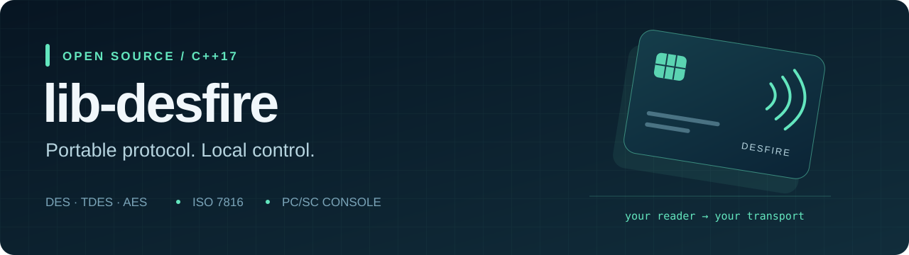

# Portable protocol. Local control.

lib-desfire provides a portable C++17 DESFire core and an optional native Windows
PC/SC card console. Bring your own transport callback, or build the local
dashboard for interactive card management.

| Guide | Contents |
| --- | --- |
| [Building](building.md) | Requirements, core and dashboard builds, CMake integration |
| [Architecture](architecture.md) | Component boundaries and session ownership |
| [HTTP API](http-api.md) | Routes, validation, errors and concurrency |
| [Release checks](release.md) | Source packaging and hardware qualification |
| [GitHub features](github.md) | Automation, security and community setup |

## Quick start

```sh
git clone https://github.com/GtechGovind/lib-desfire.git
cd lib-desfire
cmake -S . -B build/core -DCMAKE_BUILD_TYPE=Release
cmake --build build/core --config Release --parallel
cmake --install build/core --config Release --prefix install
```

Link the installed `lib_desfire::core` target with `find_package(lib_desfire 0.2 CONFIG REQUIRED)`.
See the [complete README](https://github.com/GtechGovind/lib-desfire#readme) for
features, API examples, transport requirements and the Windows console.

## Join the project

[Source](https://github.com/GtechGovind/lib-desfire) ·
[Discussions](https://github.com/GtechGovind/lib-desfire/discussions) ·
[Contributing](https://github.com/GtechGovind/lib-desfire/blob/main/CONTRIBUTING.md) ·
[Security](https://github.com/GtechGovind/lib-desfire/blob/main/SECURITY.md) ·
[Sponsor](https://github.com/sponsors/GtechGovind)

MIT licensed. Card generation and reader compatibility require hardware
qualification; offline CI does not certify real-card behavior.
